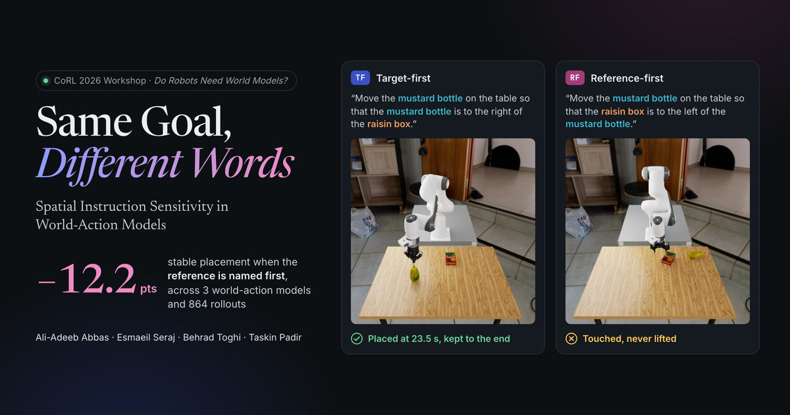

# Same Goal, Different Words

Project website for **Same Goal, Different Words: Spatial Instruction Sensitivity in World-Action Models**
(CoRL 2026 Workshop: *Do Robots Need World Models?*).

**Live site:** https://adeeb10abbas.github.io/same-goal-different-words/
**Evaluation code and evidence:** https://github.com/adeeb10abbas/world-action-model-steerability



Three world-action models get the same goal in three equivalent wordings, from the same physical starts. Naming the
reference object before the object to move lowers stable placement by 12.2 points across 864 rollouts. The home page
gives the findings as a short visual summary. The full results page (`/details/`) walks through the paired design,
every result in the paper and its appendix, the failure analysis, the language-backbone probe and the generated-future
forecasts. Every rollout is browsable in the explorer (`/explore/`).

## Layout

| Path | Contents |
| --- | --- |
| `site/` | Astro + Svelte + D3 static site. |
| `site/src/pages/` | `index.astro` (summary home page), `details.astro` (full results), `explore.astro` (rollout explorer). |
| `site/src/data/`, `site/public/data/` | Compact study data built by `pipeline/` (checked against the paper). |
| `site/qa/` | Layout QA harness: overlap, clipping, contrast and hydration checks across viewports and browsers. |
| `site/scripts/og.mjs` | Renders the social card `site/public/og.jpg` from the hero rollout pair. |
| `pipeline/` | Builds the site data from the released analysis outputs; `pipeline/cluster/` holds the media and VQA extraction jobs. |

## Media

The rollout videos, thumbnails and simulator timelines (5.9 GB, one folder per episode under `ep/<EPISODE_ID>/`) are
too large for GitHub Pages. They are hosted in the Hugging Face dataset
[`arrowhead/same-goal-different-words-media`](https://huggingface.co/datasets/arrowhead/same-goal-different-words-media),
and the build points at it through `PUBLIC_MEDIA_BASE` (see `.github/workflows/deploy.yml`).

## Develop

```bash
cd site
npm ci
npm run media               # serves ../media on :4400 (used by .env.development)
npm run dev                 # http://127.0.0.1:4321/same-goal-different-words/
npm run check               # astro check
npm run qa                  # layout QA (options at the top of qa/ui-check.mjs)
```

Pushing to `main` builds and deploys the site to GitHub Pages.
